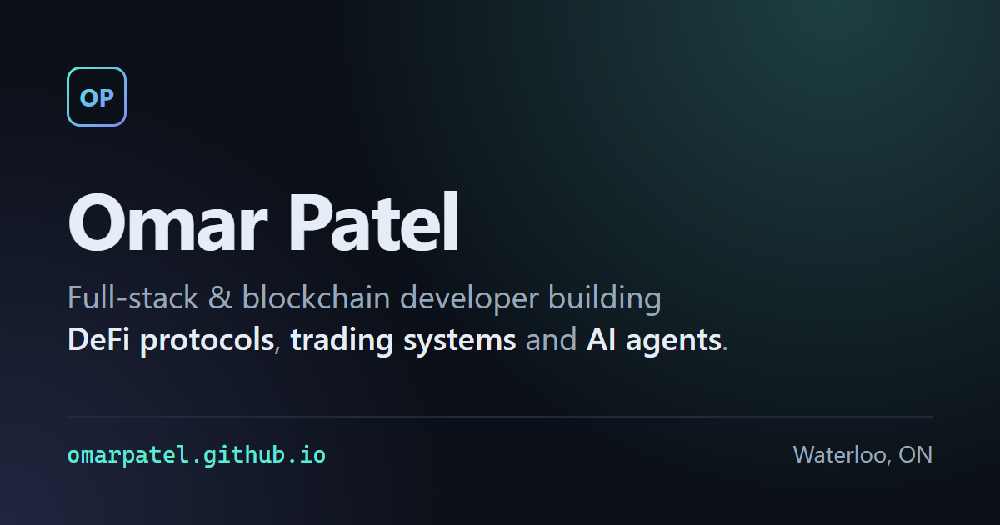

# omarpatel.github.io

Source for my personal portfolio at **[omarpatel.github.io](https://omarpatel.github.io/)**: who I am, featured projects, skills and how to reach me.

[](https://omarpatel.github.io/)

## How it's built

- Plain HTML and CSS, no framework, no build step and no JavaScript.
- No external requests at runtime: system font stack, inline SVG icons, no analytics or trackers.
- Dark theme with a single teal accent, responsive grid layout from 320px phones to wide desktops.
- Accessible by default: semantic landmarks, skip link, visible focus states, labelled lists and `prefers-reduced-motion` support.
- Open Graph and Twitter card metadata with a 1200×630 preview image.

## Files

| File | Purpose |
|---|---|
| `index.html` | The whole page: hero, about, featured projects, skills, contact |
| `styles.css` | All styling, including the mobile and reduced-motion rules |
| `favicon.svg` | Monogram favicon |
| `og.svg` | Source for the social preview image |
| `og.png` | `og.svg` rasterized at 1200×630 for link previews |

## Running locally

Open `index.html` directly in a browser, or serve the folder:

```bash
python -m http.server 8000
```

To regenerate `og.png` after editing `og.svg`, take a 1200×630 headless Chrome screenshot of it:

```bash
chrome --headless --hide-scrollbars --window-size=1200,630 --screenshot=og.png og.svg
```

## Deployment

GitHub Pages serves the `main` branch root. Every push to `main` is live within a minute or two.
